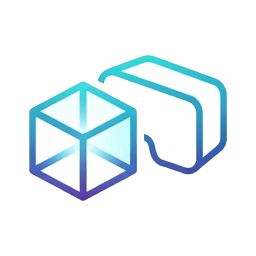

# DepthConverter

### Turn your 2D images and videos into 3D for your VR headset.

**Runs entirely on your own PC. Nothing is uploaded anywhere.**

[**See it in action**](#see-it-in-action) &nbsp;·&nbsp; [**What you get**](#what-you-get) &nbsp;·&nbsp; [**What comes out**](#what-comes-out) &nbsp;·&nbsp; [**Get access**](#get-access)

 

https://github.com/user-attachments/assets/a873e524-6b25-43cb-b816-63945ab6042c

Real capture of the real app doing real work on the GPU. The middle of each job is time-lapsed, and the clip says how much real time was cut.

 

## Why DepthConverter

Most of what you own was never filmed in 3D. DepthConverter estimates how far away every pixel is, then builds a separate view for each eye, so your photos, manga and videos gain real depth in a headset. One app covers the whole job, and **one Start button can run all of it**.

|  |  |
|---|---|
| 🔒 **Stays on your machine** | Everything runs locally with telemetry off. The only network traffic is the one-time download of the model you pick. |
| 🔍 **Sharper input, better 3D** | AI upscaling to 2x, 3x or 4x before depth and stereo, in overlapping GPU tiles so even 4K fits in limited VRAM. |
| 🧠 **Your pick of depth models** | Depth Anything V3 and V2 and MiDaS/DPT presets, or paste any HuggingFace depth model. |
| 🥽 **Made for the headset** | Output is tagged so players detect the 3D layout on their own, and the per-eye aspect ratio always matches the source. |

 

## See it in action

### 1 · Upscale (optional)

Upscale images or a whole video with Real-ESRGAN-family models. Doing this *before* depth and stereo gives the best 3D. If your GPU runs out of memory, the tile size halves itself instead of the job crashing.

https://github.com/user-attachments/assets/ca4c946c-c831-4cf9-a3dd-8aef0f9b1650

 

### 2 · Estimate depth

Pick a video, an image or a folder of images. A depth model runs on your GPU and produces a depth map for every frame, with smoothing so the depth doesn't flicker.

https://github.com/user-attachments/assets/8ff50cb6-9586-4661-8df3-9cee5dd01080

 

### 3 · Convert to side-by-side 3D

Each frame is warped pixel by pixel on the GPU into a left and right eye pair, encoded as full or half SBS. Audio is carried over from the original.

https://github.com/user-attachments/assets/0bf01231-acb4-429c-bd4b-0f7fd944b10f

 

## What comes out

Taken straight from the files the app wrote: the original, the estimated depth, and the two halves of the full-SBS frame. The eye views look almost identical because they nearly are. Each is the same frame shifted by an amount that grows with how near each pixel is, and that difference is the whole of the 3D.

https://github.com/user-attachments/assets/e3543d47-c8a6-4516-9b2f-8ce33dc57d87

 

## What you get

<table>
<tr>
<td width="50%" valign="top">

**🎬 Images and video**
- Single video, single image or a whole folder
- Natural image order, so books and manga stay in reading order
- Optional slideshow video from an image folder
- Constant RAM use, however long the video is

</td>
<td width="50%" valign="top">

**🥽 Comfortable 3D**
- Adjustable 3D strength
- **Auto convergence** keeps the subject on the screen plane
- Anti-aliased object outlines and smoothed depth edges
- Black bars removed automatically, so they never eat VR resolution

</td>
</tr>
<tr>
<td width="50%" valign="top">

**⚡ GPU first**
- FP16 inference with a batch size chosen from your free VRAM
- Halves itself on out-of-memory instead of crashing
- NVENC GPU encoding on NVIDIA cards, plus x265 and x264

</td>
<td width="50%" valign="top">

**🖱️ Simple to run**
- Three tabs, or **Run all** with one input and one output folder
- First run sets everything up by itself, FFmpeg included
- Every choice is saved and restored on the next launch

</td>
</tr>
</table>

 

## Requirements

- **Windows** is the main platform, and Linux and macOS launchers are included.
- A **CUDA-capable NVIDIA GPU** is what it's built for. NVENC encoding needs one too.
- A VR headset and a player such as Skybox to watch the result.

 

## Get access

DepthConverter is proprietary software in **private early access**. If you'd like to try it, [**open an issue**](../../issues/new?title=Access%20request) titled *Access request* and tell me what you'd use it for.

 

© 2026 Mashraki. All rights reserved. This repository contains only promotional material; DepthConverter's source code is not public and is not open source. The demo clip is from <a href="https://www.pexels.com/video/beautiful-woman-looking-at-camera-8496259/">Pexels</a>, used under the <a href="https://www.pexels.com/license/">Pexels License</a>.

